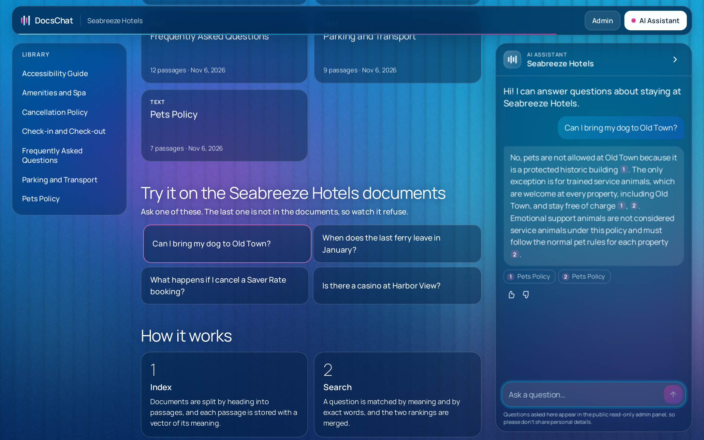

# DocsChat

An AI chatbot that answers website visitors only from a company's own documents, cites its sources, and says "I don't know" when the answer isn't there.



## Live demo

The demo runs on Seabreeze Hotels, a fictional company.

- Chat with the bot: [docschat.jobeng.online](https://docschat.jobeng.online)
- Read-only admin panel: [docschat.jobeng.online/admin](https://docschat.jobeng.online/admin) (the login is shown on the page)

## What it does

- Answers from your PDFs, Markdown files and web pages. The model is instructed to use nothing else, and text without a valid citation never reaches the visitor
- Cites every answer inline, with clickable sources that show the document and page
- Refuses when nothing relevant is found, without calling the chat model
- Understands follow-up questions and replies in the language of the question
- Joins any website with one `<script>` tag, isolated from the site's styles
- Streams answers as they are written
- Gives the owner an admin panel with documents, conversations and their sources, grouped unanswered questions, and the cost and latency of each answer
- Protects the public demo with rate limits, a paced daily spending cap, and input and output limits, with optional moderation

## How it works

**Ingestion** runs as three queued jobs with retries. `ExtractText` reads the source, `ChunkText` splits it by headings and then by size while keeping the heading and page number, and `EmbedChunks` stores the vectors. Unchanged content is skipped. A changed document replaces its chunks in one transaction, so a failed re-index leaves the previous version searchable.

**Each question** goes through these steps:

1. The question goes through the provider's moderation check when that is on, and a follow-up is rewritten into a standalone search query, using the last 6 messages.
2. Chunks are ranked by cosine similarity (pgvector, HNSW) and by full-text search, and the two rankings are merged with Reciprocal Rank Fusion. The top 6 are kept.
3. If the best similarity is below the threshold, the bot refuses without calling the chat model.
4. The model answers from those chunks only, with inline citations. Retrieved text and the question travel in blocks closed by a random tag made for that request, so neither can pose as part of the prompt.
5. Nothing is shown until the text cites a chunk that was actually retrieved. From there the answer streams over server-sent events, and an answer that never cites one is replaced by a refusal.
6. The message is stored with its tokens, cost and latency.

The system prompts are in [`resources/prompts`](resources/prompts).

## Tech stack

| Layer | Choice |
| --- | --- |
| Runtime | PHP 8.5, Laravel 13, FrankenPHP |
| Database | PostgreSQL 17 with pgvector |
| Queues and cache | Redis 8, Laravel Horizon |
| LLM access | Laravel AI SDK (OpenAI, Anthropic, any OpenAI-compatible server) behind `ChatModel` and `EmbeddingModel` interfaces |
| Widget | Vue 3, built into one standalone `widget.js` |
| Workspace | Blade, Vue 3 for the chat, a WebGL background without libraries |
| Admin panel | Blade and Tailwind CSS |
| PDF extraction | poppler-utils (`pdftotext`) |
| Quality | Pest, Larastan (level 6), Laravel Pint, GitHub Actions, an eval suite for answer quality |

## Run locally with Docker Compose

You need Docker with Compose v2. PHP and Node are not needed on the host.

```bash
cp .env.example .env
docker compose build
docker compose run --rm --no-deps app composer install
docker compose run --rm --no-deps app php artisan key:generate
docker compose run --rm node npm install
docker compose run --rm node npm run build
docker compose up -d
docker compose exec app php artisan migrate --seed
```

Seeding creates the demo bot and queues its seven documents. Embeddings need a provider key. To run without a key, set `DOCSCHAT_AI_DRIVER=fake` before seeding: answers are then canned, but the whole pipeline runs.

| Page | URL |
| --- | --- |
| Demo page | http://localhost:8000 |
| Admin panel | http://localhost:8000/admin |
| Horizon | http://localhost:8000/horizon |
| Health check | http://localhost:8000/up |

To add your own documents:

```bash
docker compose exec app php artisan docschat:ingest path/to/guide.pdf --title="Guest Guide"
docker compose exec app php artisan docschat:ingest https://example.com/faq --bot=seabreeze
```

To run the checks that CI runs:

```bash
docker compose exec app php artisan test --compact
docker compose exec app vendor/bin/pint --test
docker compose exec app vendor/bin/phpstan analyse --memory-limit=1G
```

The tests use fake models and never call a real API.

## Run evals

```bash
docker compose exec app php artisan docschat:eval
```

This sends the 36 questions in [`tests/evals/questions.yaml`](tests/evals/questions.yaml) through the real pipeline, including follow-ups that need history and questions the documents cannot answer. It prints the source hit rate, correct refusals, false refusals, and average cost and latency, and saves a report to `storage/evals`.

With a real provider a run spends a few cents. With the fake driver the numbers say nothing about answer quality, and the command warns about that. Use `--bot` and `--questions` to test another bot.

Latest run on the demo documents:

| Metric | Result |
| --- | --- |
| Source hit rate | 28/28 |
| Answers with the expected facts | 21/21 |
| False refusals | 0/28 |
| Correct refusals | 6/8 |
| Errors | 0 |
| Average cost per question | $0.0033 |
| Average latency | about 1 s |

## Configuration

Secrets and deployment settings live in `.env`. The rest is in [`config/docschat.php`](config/docschat.php), including the model price table.

| Variable | Default | Purpose |
| --- | --- | --- |
| `OPENAI_API_KEY`, `ANTHROPIC_API_KEY` | | Provider keys |
| `OPENAI_COMPATIBLE_URL`, `OPENAI_COMPATIBLE_API_KEY` | | Any server that speaks the OpenAI API |
| `DOCSCHAT_AI_DRIVER` | `laravel-ai` | `fake` runs without a provider and is refused in production |
| `DOCSCHAT_CHAT_PROVIDER` | `openai` | `openai`, `anthropic` or `openai-compatible` |
| `DOCSCHAT_EMBEDDING_PROVIDER` | `openai` | `openai` or `openai-compatible` |
| `DOCSCHAT_CHAT_EXTRA_BODY` | | JSON merged into requests to an OpenAI-compatible server |
| `DOCSCHAT_MODEL_PRICES` | | JSON with prices for models outside the price table |
| `DOCSCHAT_CHAT_MODEL`, `DOCSCHAT_REWRITE_MODEL` | `gpt-6-luna` | Models for answers and query rewriting |
| `DOCSCHAT_EMBEDDING_MODEL` | `text-embedding-3-small` | Changing it re-embeds on the next seed |
| `DOCSCHAT_RETRIEVAL_MIN_SIMILARITY` | `0.3` | Below this the bot refuses |
| `DOCSCHAT_MAX_ANSWER_TOKENS` | `400` | Output limit per answer |
| `DOCSCHAT_MODERATION_ENABLED` | `true` | Checks questions against the provider's free moderation endpoint |
| `DOCSCHAT_CONVERSATION_RETENTION_DAYS` | `30` | Conversations are deleted this long after their last message |
| `DAILY_BUDGET_USD` | `2` | Above this the bot stops calling models for the day |
| `TRUSTED_PROXIES` | | Comma-separated addresses, or `*`, when behind a proxy |
| `ADMIN_EMAIL`, `ADMIN_PASSWORD` | | Owner login. Without a password it cannot log in. In production, use a hash from `php artisan docschat:hash-password` |
| `DEMO_EMAIL`, `DEMO_PASSWORD` | `demo@example.com`, `demo` | Read-only login, shown on the login page |
| `DEMO_BOT_KEY` | `pk_seabreeze_demo` | The bot shown on the demo page |
| `DEMO_REPOSITORY_URL`, `DEMO_AUTHOR_URL`, `DEMO_AUTHOR_LABEL` | | Links on the demo page. Empty links are hidden. |
| `DOMAIN` | `localhost` | Public domain in production |
| `APP_PORT`, `PROXY_BIND_ADDRESS` | `8000`, `172.17.0.1` | Where the app listens behind a reverse proxy |
| `FRANKENPHP_NUM_THREADS` | `16` | Web server threads. Each streamed answer holds one. |

### Using an OpenAI-compatible server

Answers and embeddings can come from any server with the OpenAI `chat/completions` and `embeddings` endpoints, without a code change:

```bash
OPENAI_COMPATIBLE_URL=https://llm.example.com/v1
OPENAI_COMPATIBLE_API_KEY=your-key
DOCSCHAT_CHAT_PROVIDER=openai-compatible
DOCSCHAT_EMBEDDING_PROVIDER=openai-compatible
DOCSCHAT_CHAT_MODEL=my-chat-model
DOCSCHAT_REWRITE_MODEL=my-chat-model
DOCSCHAT_EMBEDDING_MODEL=my-embedding-model
DOCSCHAT_CHAT_EXTRA_BODY='{"chat_template_kwargs":{"enable_thinking":false}}'
DOCSCHAT_MODEL_PRICES='{"my-chat-model":{"input":"0.10","output":"0.50"},"my-embedding-model":{"input":"0.02","output":"0"}}'
DOCSCHAT_MODERATION_ENABLED=false
```

Every configured model needs a price, because the daily budget adds them up. The vector columns hold 1536 dimensions, so an embedding model of another size takes a migration. The similarity threshold depends on the embedding model: run the evals after changing it. Moderation calls OpenAI directly, so turn it off when the server has no OpenAI key.

### Demo protection

| Protection | Limit |
| --- | --- |
| Messages per visitor | 20 per hour and 60 per day, with a friendly 429 and `Retry-After` |
| Messages per IPv4 /24 | 60 per hour and 200 per day |
| Answers at once | 6 overall and 2 per visitor, so streams cannot take every web server thread |
| Other sites | The API refuses requests with a foreign `Origin`, and CORS is off |
| Daily spend | `DAILY_BUDGET_USD` across all bots, opening up through the day, so a burst pauses the bot for a while rather than until midnight |
| Pages | 120 per minute per visitor, and public pages start no session |
| Question length | 500 characters |
| Answer length | 400 tokens |
| Conversation history | the last 6 messages |
| API request body | 16 KB, enforced by the web server |
| Admin panel | the demo account can read everything and change nothing, and contact details and links typed by visitors are hidden from it |

Limits count per IPv4 address or per IPv6 /48 network, because one IPv6 customer can hold thousands of addresses. Behind a proxy such as Cloudflare, set `TRUSTED_PROXIES`, or all visitors will share one limit and the API will refuse the chat itself, because its HTTPS origin will not match what the application sees. Only do that when the origin cannot be reached directly, because a trusted proxy header can otherwise be forged. Prefer addresses to `*`: with `*` Laravel trusts every hop and takes the leftmost address, which the visitor controls unless the proxy overwrites the header.

The application refuses to start if a configured model is missing from the price table, because the daily cap could not count its cost.

### Embedding the widget

```html
<script src="https://YOUR-DOMAIN/widget.js" data-bot="PUBLIC_KEY" async></script>
```

Optional attributes are `data-color` (a hex color), `data-position` (`left` or `right`), `data-greeting`, and `data-open="true"` to open the chat on load on wide screens.

### Production

Set `DOMAIN`, a strong `DB_PASSWORD` and `REDIS_PASSWORD`, `ADMIN_PASSWORD` and the provider keys in `.env`, and generate the application key. Use `php artisan docschat:hash-password` for `ADMIN_PASSWORD` and put the hash in single quotes. Set a monthly limit for the API key in the provider's dashboard as well: the daily budget counts what the application knows about, and only the provider can enforce a hard stop.

```bash
sed -i "s|^APP_KEY=.*|APP_KEY=base64:$(openssl rand -base64 32)|" .env
```

Compose stops with an error if `DOMAIN`, `APP_KEY`, `DB_PASSWORD` or `REDIS_PASSWORD` is empty, and the containers refuse to start with an example password or an `ADMIN_PASSWORD` under 16 characters. Postgres reads the password only when its volume is first created, so to change it later use `ALTER USER` as well as `.env`.

```bash
docker compose -f docker-compose.yml -f docker-compose.prod.yml up -d --build
docker compose -f docker-compose.yml -f docker-compose.prod.yml exec app php artisan db:seed --force
```

FrankenPHP (Caddy) issues the HTTPS certificate for `DOMAIN` automatically, and migrations run when the app starts. The database and Redis ports are not exposed, every container has a memory limit and a restart policy, logs go to Docker with rotation, and session cookies are HTTPS-only.

### Production behind a reverse proxy

On a server where another nginx already owns ports 80 and 443, that nginx terminates HTTPS and DocsChat serves plain HTTP behind it. Add this to `.env`, so that plain `docker compose` picks up all three files:

```bash
COMPOSE_FILE=docker-compose.yml:docker-compose.prod.yml:docker-compose.proxy.yml
```

[`docker-compose.proxy.yml`](docker-compose.proxy.yml) publishes the app only on the Docker bridge address (`172.17.0.1:8000`), which other containers can reach and the internet cannot. It sets `TRUSTED_PROXIES` to the private address ranges, so per-visitor limits see the real client address, and it adds CPU limits so that DocsChat cannot starve its neighbours.

Check the bridge address with `ip -4 addr show docker0`, then give the proxy the site in [`docker/nginx/docschat.conf.template`](docker/nginx/docschat.conf.template). Issue the certificate before adding the site, because nginx does not start with a missing certificate file, and that would stop every other site on the server. The site raises the upload limit to 25 MB, turns off response buffering for the streamed answers, and keeps the upstream a literal address, so nginx still starts while DocsChat is down.

## Project structure

```text
app/
├── Actions/        Single-purpose use cases: Admin, Answer, Ingestion
├── Ai/             ChatModel and EmbeddingModel interfaces, SDK adapters, fakes
├── Auth/           Admin accounts defined in the environment
├── Console/        docschat:ingest and docschat:eval
├── Data/           Typed value objects
├── Http/           Thin controllers, form requests, the SSE response
├── Jobs/           The queued ingestion pipeline
├── Models/         Bot, Document, Chunk, Conversation, Message
└── Services/       Retrieval, prompts, costs, budget, extraction, chunking, evals
config/docschat.php All application settings and the model price table
database/seed-docs/ The fictional Seabreeze Hotels documents
docker/             Web server, PHP and entrypoint configuration
resources/prompts/  System prompts
resources/views/    Admin panel and demo page
resources/widget/   The Vue widget and its launcher
resources/workspace/ The document workspace: background, panels, page changes
tests/              Pest tests and the eval questions
```

## Limitations

- **Scanned PDFs are not supported.** There is no OCR, so a PDF needs a text layer.
- **Web pages are added one at a time.** There is no site crawler.
- **The admin panel manages one bot.** The data model supports many, but there is no bot switcher, user management or billing.
- **The similarity threshold needs tuning.** The default suits short policy documents like the demo's. Check it with the evals on any new document set.
- **Token counts for chunking are estimates.** Costs use the provider's reported usage when it is available, and an estimate otherwise.
- **The daily cap covers answers only,** not the embedding of new documents, and it trusts the price table in the configuration.
- **Rate limits follow the network.** Visitors behind one shared address or IPv6 /48 share a limit, and someone with many networks can still get around it. There is no CAPTCHA.
- **The grounding check is not proof.** It stops text with no citation, but a model talked into adding a valid citation gets through, and an uncited refusal in the visitor's language becomes the English one.
- **The admin login has no second factor.** The panel is meant to sit behind a strong password and the login limits.
- **Conversations on the public demo are visible** in the read-only admin panel, and the demo page and chat both say so.
- **The interface is in English,** though answers follow the language of the question.
